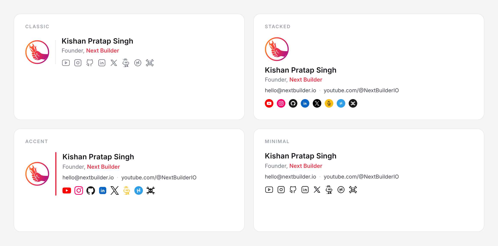

<div align="center">


# Signature Studio

**Professional email signatures, ready in two minutes.**

Free · Open source · No sign-up · Works in Gmail, Apple Mail and Outlook

[**Open Signature Studio →**](https://nextbuilder.github.io/Email-Signature/)

<br>


</div>

<br>

## Features

- **4 templates:** Classic, Stacked, Minimal and Accent. Each one is built from email-safe tables and inline styles.
- **50 platforms:** social, developer, maker, creator, chat and contact icons in one consistent set.
- **3 icon styles × 13 colours:** Outline, Solid or Badge, in a neutral palette or each platform's official brand colour.
- **Live preview:** switch between light and dark inboxes, and between desktop and phone widths.
- **One-click copy:** paste straight into your email app's signature box. You can also copy the raw HTML or download it as a file.
- **Private by design:** everything runs in your browser. Nothing is uploaded, and your draft is saved only on your device.
- **Retina-sharp:** every icon is exported at 4× and served from GitHub Pages.

<div align="center"></div>

## Supported platforms

| Group | Platforms |
|---|---|
| **Social** | YouTube · Instagram · X · LinkedIn · Facebook · TikTok · Threads · Bluesky · Mastodon · Pinterest · Reddit · Snapchat · Tumblr |
| **Build** | GitHub · GitLab · Stack Overflow · CodePen · Product Hunt · Figma · Dribbble · Behance · Notion |
| **Make** | Instructables · Hackster · Hackaday · Printables · Thingiverse · Arduino |
| **Chat** | WhatsApp · Telegram · Discord · Signal |
| **Create** | Twitch · Spotify · SoundCloud · Vimeo · Medium · Substack · Patreon · Ko-fi · Gumroad · Linktree · Unsplash |
| **Work** | Upwork · Fiverr · Calendly |
| **Contact** | Website · Email · Phone · Location |

## Quick start

1. Open **[Signature Studio](https://nextbuilder.github.io/Email-Signature/)** and click **Start blank**.
2. Choose a template, then fill in your details.
3. Add a photo or logo: paste a public image link, or use your GitHub avatar.
4. Pick your platforms and paste your profile links.
5. Choose an accent colour and an icon style.
6. Click **Copy signature**, then follow the steps below for your email app.

## Add it to your email

### Gmail (computer)

> **Direct link:** [mail.google.com/mail/u/0/#settings/general](https://mail.google.com/mail/u/0/#settings/general)

1. Click **Copy signature** in Signature Studio.
2. Open **Gmail → Settings → See all settings → General**. The direct link above takes you straight there.
3. Scroll to **Signature**, click **Create new** and give it a name.
4. Click inside the signature box and paste with `Ctrl + V` (`⌘ + V` on Mac).
5. Under **Signature defaults**, choose it for **For new emails use** and **On reply/forward use**.
6. Scroll to the bottom and click **Save Changes**.

If you're signed in to several Google accounts, change `/u/0/` in the link to `/u/1/`, `/u/2/` and so on until it opens the right inbox.

### Gmail app (iPhone, iPad, Android)

Set the signature up on a computer first.

- **iPhone & iPad:** Menu ☰ → **Settings** → your account → **Signature settings** → turn **Mobile Signature** off. The app then uses your computer signature.
- **Android:** Menu ☰ → **Settings** → your account → **Mobile signature** → leave it empty. Send yourself a test email to check it appears.

### Apple Mail (Mac)

1. Click **Copy signature**.
2. Open **Mail → Settings → Signatures**, pick your account and click **+**.
3. Paste into the right-hand box with `⌘ + V`.
4. Untick **Always match my default message font**, then choose the signature under **Choose Signature**.

### Outlook

1. Click **Copy signature**.
2. **Outlook on the web / new Outlook:** Settings ⚙ → **Account** → **Signatures** → **New signature**.
   **Classic Outlook (Windows):** File → Options → Mail → **Signatures…** → **New**.
3. Paste, set it as the default for new messages and replies, then click **Save**.

## How it works

Email apps strip scripts, external stylesheets and SVG, so Signature Studio writes table-based HTML with inline styles only. Icons are PNG images hosted on GitHub Pages, because email apps can only show images that have a public link. The output stays well under Gmail's 10,000-character signature limit, and the editor shows you the live count.

## Run your own copy

1. **Fork** this repository.
2. In your fork, open **Settings → Pages**, set **Source** to **Deploy from a branch**, then choose **`main`** and **`/ (root)`**.
3. Your studio goes live at `https://<your-username>.github.io/Email-Signature/`, and its icons are served from your own fork.

To rebuild or extend the icon set:

```bash
npm install
npm run build:icons
```

Add a platform in [`scripts/build-icons.mjs`](scripts/build-icons.mjs). The script renders every style and colour and updates [`app/platforms.js`](app/platforms.js).

## Project structure

```
Email-Signature/
├── index.html              # Signature Studio app
├── app/
│   ├── studio.css          # Interface styles
│   ├── studio.js           # Editor, preview and signature builder
│   └── platforms.js        # Generated platform list
├── icons/                  # 1,900 PNG icons: {outline,solid,badge}/{colour}/{platform}.png
├── scripts/
│   └── build-icons.mjs     # Icon build script
├── examples/
│   └── next-builder.html   # Example signature
└── assets/                 # Favicon, screenshots and example images
```

## Credits

- Outline icons are based on [Tabler Icons](https://tabler.io/icons) (MIT).
- Brand marks are based on [Simple Icons](https://simpleicons.org) (CC0).
- All brand names and logos are trademarks of their respective owners.

## License

[MIT](LICENSE) © Kishan Pratap Singh · [Next Builder](https://youtube.com/@NextBuilderIO)

<div align="center">
<br>

[YouTube](https://youtube.com/@NextBuilderIO) · [Instagram](https://instagram.com/next_builder) · [GitHub](https://github.com/NextBuilder) · [LinkedIn](https://www.linkedin.com/company/nextbuilderio/) · [X](https://x.com/NEXTBUILDERIO) · [Instructables](https://www.instructables.com/member/Next%20Builder%20DIY/) · [Hackster](https://hackster.io/NEXTBUILDER) · [Hackaday](https://hackaday.io/NextBuilder)

</div>
