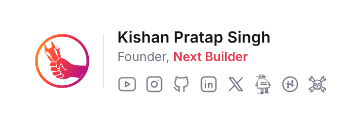

<div align="center">

# Next Builder · Email Signature

A clean, lightweight HTML email signature for **Kishan Pratap Singh**, Founder of Next Builder.



</div>

## Overview

- **Table-based HTML** with inline styles — renders consistently in Gmail, Apple Mail and Outlook.
- **Retina-ready assets** — PNGs exported at 4–5× and displayed at 20 px (icons) and 56 px (emblem).
- **Responsive by size** — about 300 px wide, so it fits phone screens without wrapping.
- **Light and dark mode** — transparent icons in a neutral gray that read on both backgrounds.

## Links

| Platform | Profile |
|---|---|
| YouTube | [@NextBuilderIO](https://youtube.com/@NextBuilderIO) |
| Instagram | [next_builder](https://instagram.com/next_builder) |
| GitHub | [NextBuilder](https://github.com/NextBuilder) |
| LinkedIn | [nextbuilderio](https://www.linkedin.com/company/nextbuilderio/) |
| X | [NEXTBUILDERIO](https://x.com/NEXTBUILDERIO) |
| Instructables | [Next Builder DIY](https://www.instructables.com/member/Next%20Builder%20DIY/) |
| Hackster | [NEXTBUILDER](https://hackster.io/NEXTBUILDER) |
| Hackaday | [NextBuilder](https://hackaday.io/NextBuilder) |

## Structure

```
Email-Signature/
├── signature.html        # The signature markup
└── assets/
    ├── emblem.png        # Next Builder emblem (192 × 192)
    ├── preview.png       # README preview
    └── icons/            # Social icons (96 × 96, gray, transparent)
```

## Install

### Gmail (desktop)

1. Open `signature.html` in a browser and select the whole signature (`Ctrl/Cmd + A`), then copy.
2. In Gmail, go to **Settings → See all settings → General → Signature → Create new**.
3. Paste, then set it as the default for **new emails** and **replies/forwards**.
4. Click **Save Changes** at the bottom of the page.

### Gmail app (iPhone / iPad)

**Settings → your account → Signature settings → turn Mobile Signature off.** The app then uses the desktop signature.

### Gmail app (Android)

**Settings → your account → Mobile signature → leave it empty.** Send yourself a test email to confirm the desktop signature is applied.

## Customize

Edit `signature.html` directly. Images load from this repository's `main` branch, so a changed icon goes live in every signature after you push it.

## Credits

Outline icons for YouTube, Instagram, GitHub, LinkedIn and X are based on [Tabler Icons](https://tabler.io/icons) (MIT). Instructables, Hackster and Hackaday marks are based on [Simple Icons](https://simpleicons.org) (CC0). All brand logos belong to their respective owners.

---

<div align="center">

Made by [Next Builder](https://youtube.com/@NextBuilderIO)

</div>
